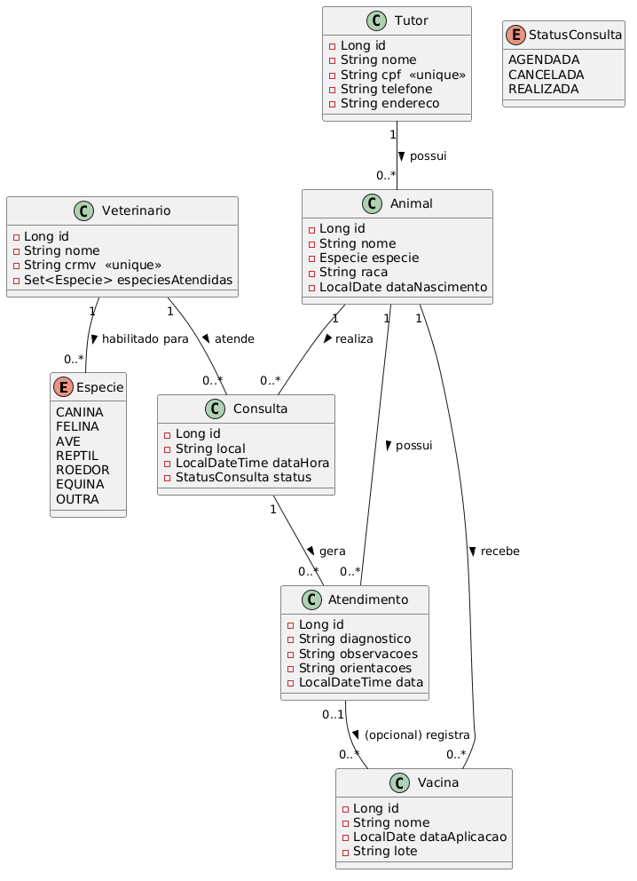
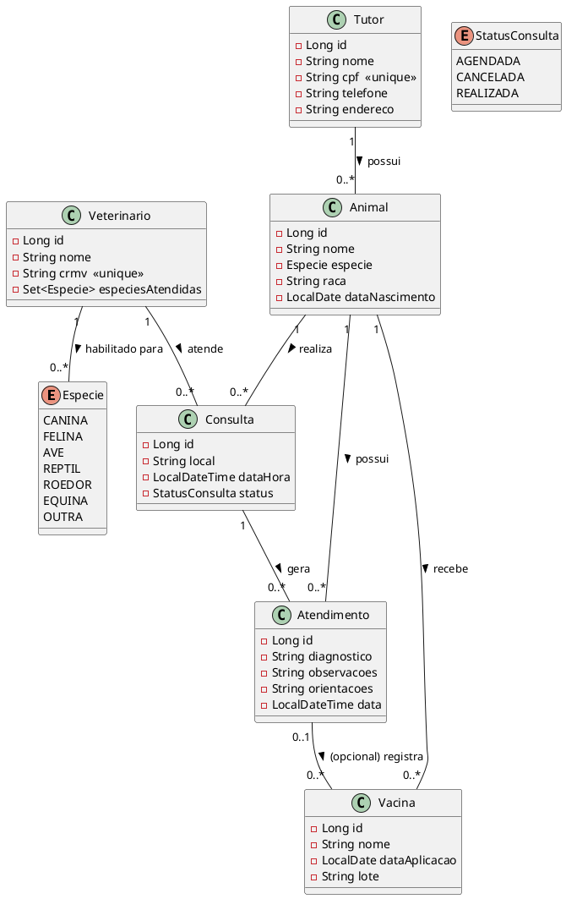

# Diagrama de Classes — PetCare Digital Solutions

Diagrama de classes das entidades JPA do domínio da clínica veterinária, com atributos e
relacionamentos (cardinalidade).

Representado também em sintaxe **PlantUML** abaixo (pode ser colado em
https://www.plantuml.com/plantuml/uml/ ou em qualquer plugin PlantUML para regenerar a imagem).

## Descrição textual das entidades e relacionamentos

### Tutor
- **Atributos:** id, nome, cpf (único), telefone, endereco.
- **Relacionamento:** 1 Tutor → N Animal (`@OneToMany(mappedBy = "tutor")`).

### Animal
- **Atributos:** id, nome, especie (enum), raca, dataNascimento.
- **Relacionamento:** N Animal → 1 Tutor (`@ManyToOne`). Um animal tem exatamente um tutor
  responsável; um tutor pode ter vários animais.

### Veterinario
- **Atributos:** id, nome, crmv (único), especiesAtendidas (coleção de enum `Especie`,
  mapeada com `@ElementCollection` em tabela separada `veterinario_especie`).
- **Relacionamento:** N Veterinario → N Especie (coleção de valores, não é uma entidade própria).

### Consulta
- **Atributos:** id, local, dataHora (LocalDateTime), status (enum: AGENDADA, CANCELADA, REALIZADA).
- **Relacionamentos:**
  - N Consulta → 1 Animal (`@ManyToOne`)
  - N Consulta → 1 Veterinario (`@ManyToOne`)
- **Regra de negócio (camada de serviço):**
  - Não é permitido agendar duas consultas do mesmo veterinário em horário conflitante
    (verificação de sobreposição considerando uma janela de 60 minutos por consulta).
  - Não é permitido agendar uma consulta com um veterinário que não atenda a espécie do animal.
  - Cancelamento apenas altera o campo `status` para `CANCELADA` — o registro nunca é
    fisicamente removido do banco.

### Atendimento (prontuário)
- **Atributos:** id, diagnostico, observacoes, orientacoes, data.
- **Relacionamentos:**
  - N Atendimento → 1 Consulta (`@ManyToOne`) — o atendimento é o registro clínico resultante
    de uma consulta.
  - N Atendimento → 1 Animal (`@ManyToOne`) — referência direta para facilitar consultas de
    histórico por animal.

### Vacina
- **Atributos:** id, nome, dataAplicacao, lote.
- **Relacionamentos:**
  - N Vacina → 1 Animal (`@ManyToOne`, obrigatório).
  - N Vacina → 0..1 Atendimento (`@ManyToOne`, opcional) — uma vacina pode ter sido aplicada
    durante um atendimento específico, ou de forma avulsa.

## Cardinalidades resumidas

| Origem       | Relação | Destino      | Cardinalidade |
|--------------|---------|--------------|---------------|
| Tutor        | possui  | Animal       | 1 : N         |
| Animal       | realiza | Consulta     | 1 : N         |
| Veterinario  | atende  | Consulta     | 1 : N         |
| Consulta     | gera    | Atendimento  | 1 : N         |
| Animal       | possui  | Atendimento  | 1 : N         |
| Animal       | recebe  | Vacina       | 1 : N         |
| Atendimento  | registra| Vacina       | 0..1 : N (opcional) |
| Veterinario  | habilitado para | Especie | N : N (element collection) |
