# PetCare Digital Solutions — API REST Clínica Veterinária

Projeto acadêmico da atividade **"API REST com Spring Boot"**.

**Nome:** Thiago X | **RA:** 240108

## Descrição

API REST para gestão de uma clínica veterinária fictícia (PetCare Digital Solutions),
cobrindo três módulos:

1. **Cadastro de animais e tutores** — tutores e seus animais (um tutor pode ter vários animais).
2. **Veterinários e consultas** — cadastro de veterinários (com as espécies que cada um pode
   atender) e agendamento de consultas, com regras de negócio que impedem conflito de horário
   do mesmo veterinário e consultas com veterinário não habilitado para a espécie do animal.
   Consultas podem ser canceladas (o registro nunca é apagado, apenas o status muda).
3. **Prontuário e vacinação** — atendimentos (prontuário clínico vinculado a uma consulta) e
   vacinas aplicadas aos animais, com um endpoint de histórico completo por animal.

## Tecnologias

- Java 17
- Spring Boot 3.3.4 (Web, Data JPA, Validation)
- Banco H2 em arquivo (padrão, não precisa instalar nada) — com perfil alternativo para PostgreSQL
- Lombok
- Bean Validation (jakarta.validation)
- Maven (com Maven Wrapper incluso)

## Arquitetura

```
com.petcare.clinica
 ├── entity       // entidades JPA (Tutor, Animal, Veterinario, Consulta, Atendimento, Vacina, enums)
 ├── repository   // interfaces JpaRepository com consultas personalizadas (@Query / method naming)
 ├── service      // interfaces de serviço
 │    └── impl    // implementações com as regras de negócio
 ├── controller   // REST controllers (ResponseEntity + status codes)
 ├── dto          // records de request/response com Bean Validation
 └── exception    // exceptions customizadas + @RestControllerAdvice global
```

Toda regra de negócio (conflito de horário, espécie não habilitada, CPF/CRMV duplicado,
cancelamento) fica na camada de **service**, nunca no controller ou no repository.

## Como rodar

Pré-requisitos: JDK 17 instalado. Maven não é necessário — o projeto inclui o **Maven Wrapper**.

Na raiz do projeto (`D:\spring`):

```bash
# Windows (PowerShell/cmd)
mvnw.cmd spring-boot:run

# Linux/Mac ou Git Bash
./mvnw spring-boot:run
```

A aplicação sobe em `http://localhost:8080`.

O banco H2 é um arquivo local criado em `./data/petcare.mv.db` na primeira execução —
não é necessário instalar nenhum banco de dados.

### Rodando com PostgreSQL (opcional)

Ajuste `src/main/resources/application-postgres.properties` com as credenciais do seu banco e rode:

```bash
./mvnw spring-boot:run -Dspring-boot.run.profiles=postgres
```

### Console do H2

Com a aplicação rodando, acesse:

```
http://localhost:8080/h2-console
```

Configuração de conexão:

- **JDBC URL:** `jdbc:h2:file:./data/petcare;AUTO_SERVER=TRUE`
- **User Name:** `sa`
- **Password:** (em branco)

## Endpoints principais

### Tutores (`/api/tutores`)

| Método | Endpoint              | Descrição                 |
|--------|------------------------|----------------------------|
| POST   | /api/tutores           | Cria um tutor (201)        |
| GET    | /api/tutores           | Lista todos os tutores     |
| GET    | /api/tutores/{id}      | Busca tutor por id (404 se não existir) |
| PUT    | /api/tutores/{id}      | Atualiza tutor             |
| DELETE | /api/tutores/{id}      | Remove tutor (204)         |

Exemplo de corpo (POST):

```json
{
  "nome": "Maria Souza",
  "cpf": "123.456.789-00",
  "telefone": "(11) 99999-0000",
  "endereco": "Rua das Flores, 123 - São Paulo/SP"
}
```

### Animais (`/api/animais`)

| Método | Endpoint                        | Descrição |
|--------|----------------------------------|-----------|
| POST   | /api/animais                     | Cria um animal (201) |
| GET    | /api/animais?tutorId={id}        | Lista animais (opcionalmente por tutor) |
| GET    | /api/animais/{id}                | Busca animal por id |
| GET    | /api/animais/{id}/historico      | Histórico completo (atendimentos + vacinas) |
| PUT    | /api/animais/{id}                | Atualiza animal |
| DELETE | /api/animais/{id}                | Remove animal (204) |

Exemplo de corpo (POST):

```json
{
  "nome": "Rex",
  "especie": "CANINA",
  "raca": "Labrador",
  "dataNascimento": "2021-05-10",
  "tutorId": 1
}
```

Valores aceitos para `especie`: `CANINA`, `FELINA`, `AVE`, `REPTIL`, `ROEDOR`, `EQUINA`, `OUTRA`.

### Veterinários (`/api/veterinarios`)

| Método | Endpoint                             | Descrição |
|--------|----------------------------------------|-----------|
| POST   | /api/veterinarios                      | Cria um veterinário (201) |
| GET    | /api/veterinarios?especie={ESPECIE}    | Lista (opcionalmente filtra por espécie habilitada) |
| GET    | /api/veterinarios/{id}                 | Busca por id |
| PUT    | /api/veterinarios/{id}                 | Atualiza |
| DELETE | /api/veterinarios/{id}                 | Remove (204) |

Exemplo de corpo (POST):

```json
{
  "nome": "Dr. João Pereira",
  "crmv": "CRMV-SP 12345",
  "especiesAtendidas": ["CANINA", "FELINA"]
}
```

### Consultas (`/api/consultas`)

| Método | Endpoint                                              | Descrição |
|--------|----------------------------------------------------------|-----------|
| POST   | /api/consultas                                             | Agenda consulta (201, 409 se houver conflito de horário, 400 se espécie não habilitada) |
| GET    | /api/consultas?animalId=&veterinarioId=&status=            | Lista / filtra consultas |
| GET    | /api/consultas/{id}                                        | Busca por id |
| PATCH  | /api/consultas/{id}/cancelar                               | Cancela (muda status para CANCELADA, não deleta) |
| PATCH  | /api/consultas/{id}/realizar                               | Marca como REALIZADA |

Exemplo de corpo (POST):

```json
{
  "animalId": 1,
  "veterinarioId": 1,
  "local": "Sala 2 - Unidade Centro",
  "dataHora": "2026-12-10T14:30:00"
}
```

Regras de negócio aplicadas no `ConsultaServiceImpl`:
- não permite agendar dois atendimentos do mesmo veterinário em horário conflitante (janela de 60 min);
- não permite agendar consulta com veterinário não habilitado para a espécie do animal;
- cancelar uma consulta apenas altera o `status` para `CANCELADA` (o registro não é apagado).

### Atendimentos / Prontuário (`/api/atendimentos`)

| Método | Endpoint                          | Descrição |
|--------|-------------------------------------|-----------|
| POST   | /api/atendimentos                   | Cria um atendimento vinculado a uma consulta (201) |
| GET    | /api/atendimentos?animalId=         | Lista (opcionalmente por animal) |
| GET    | /api/atendimentos/{id}              | Busca por id |
| PUT    | /api/atendimentos/{id}              | Atualiza |
| DELETE | /api/atendimentos/{id}              | Remove (204) |

Exemplo de corpo (POST):

```json
{
  "consultaId": 1,
  "diagnostico": "Otite externa leve",
  "observacoes": "Animal apresentou coceira recorrente na orelha direita",
  "orientacoes": "Aplicar medicação prescrita por 7 dias e retornar para reavaliação",
  "data": "2026-12-10T15:00:00"
}
```

### Vacinas (`/api/vacinas`)

| Método | Endpoint                      | Descrição |
|--------|----------------------------------|-----------|
| POST   | /api/vacinas                      | Registra aplicação de vacina (201) |
| GET    | /api/vacinas?animalId=            | Lista (opcionalmente por animal, ordenado por data) |
| GET    | /api/vacinas/{id}                 | Busca por id |
| PUT    | /api/vacinas/{id}                 | Atualiza |
| DELETE | /api/vacinas/{id}                 | Remove (204) |

Exemplo de corpo (POST):

```json
{
  "nome": "V10 (Polivalente Canina)",
  "dataAplicacao": "2026-11-01",
  "lote": "L2026-A47",
  "animalId": 1,
  "atendimentoId": 1
}
```

(`atendimentoId` é opcional.)

### Histórico do animal

```
GET /api/animais/{id}/historico
```

Retorna um objeto consolidado com dados do animal, nome do tutor, lista de atendimentos
(prontuário) e lista de vacinas aplicadas — tudo ordenado por data mais recente primeiro.

## Códigos de status HTTP utilizados

- `200 OK` — consultas bem-sucedidas (GET)
- `201 Created` — criação de recurso (POST)
- `204 No Content` — remoção bem-sucedida (DELETE)
- `400 Bad Request` — dados inválidos (Bean Validation) ou espécie não habilitada
- `404 Not Found` — recurso não encontrado
- `409 Conflict` — conflito de horário ou duplicidade (CPF/CRMV já cadastrado)

## Testes manuais

Veja a pasta `thunder-tests/` com as requisições prontas (sucesso e erro) para importar:

- `postman-collection.json` — importar no **Thunder Client** (Collections → ... → Import → escolher formato "Postman")
- `requests.http` — alternativa para a extensão **REST Client** do VS Code

### Prints dos testes (Thunder Client)

Abaixo os principais cenários testados, cobrindo sucesso e erro nos três módulos:

| Cenário | Print |
|---|---|
| Criar tutor (sucesso 201) | 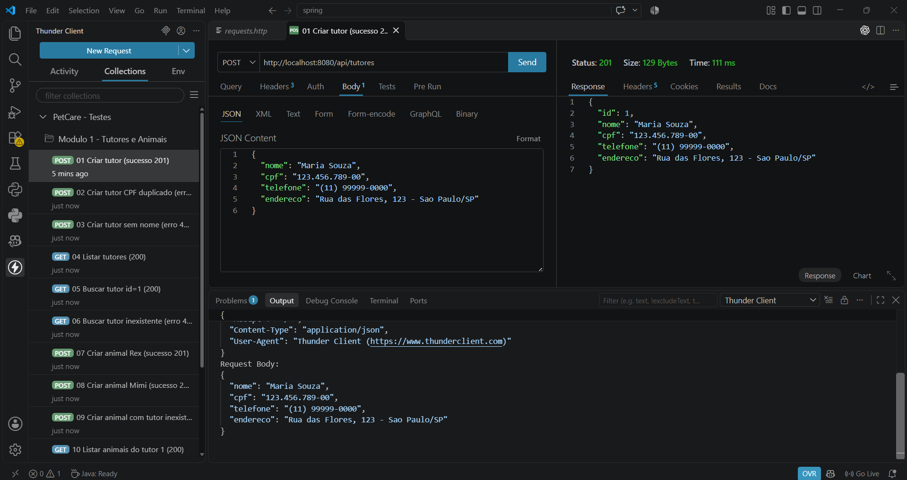 |
| Criar tutor com CPF duplicado (erro 409) | 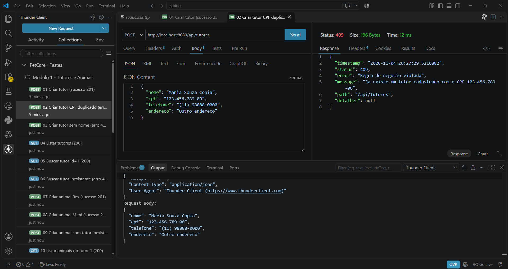 |
| Criar animal Rex (sucesso 201) | 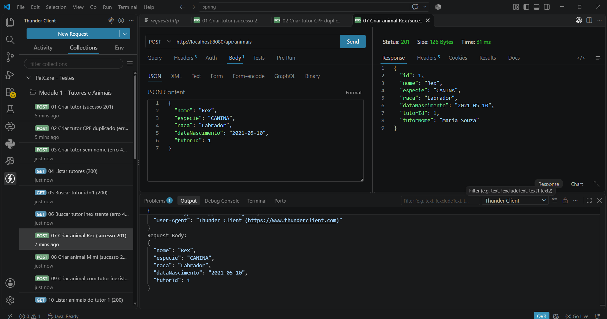 |
| Criar animal Mimi (sucesso 201) | 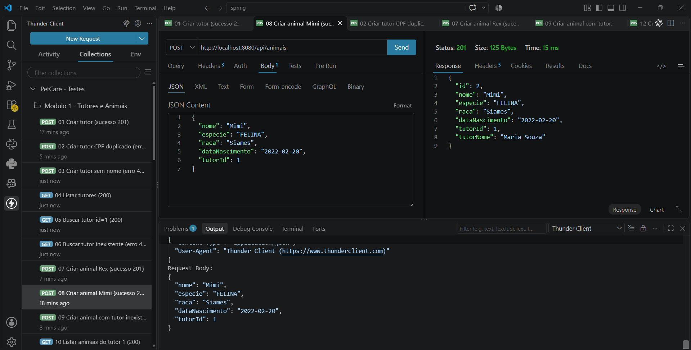 |
| Criar animal com tutor inexistente (erro 404) | 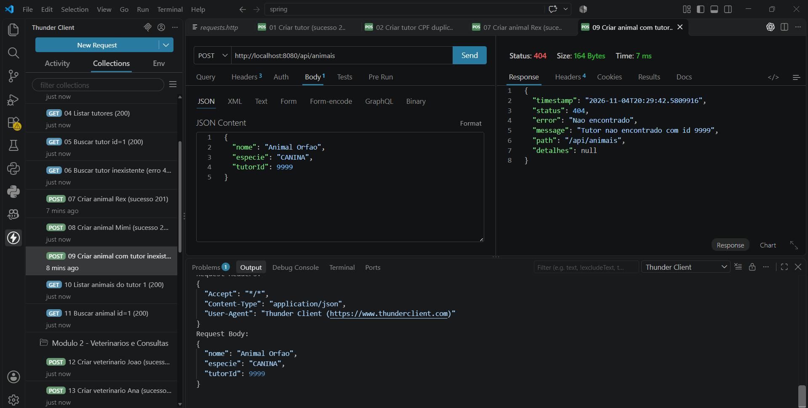 |
| Criar veterinário (sucesso 201) | 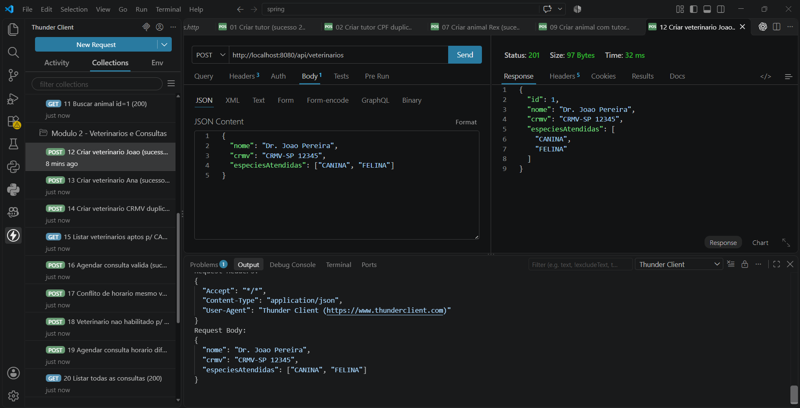 |
| Criar segundo veterinário (sucesso 201) | 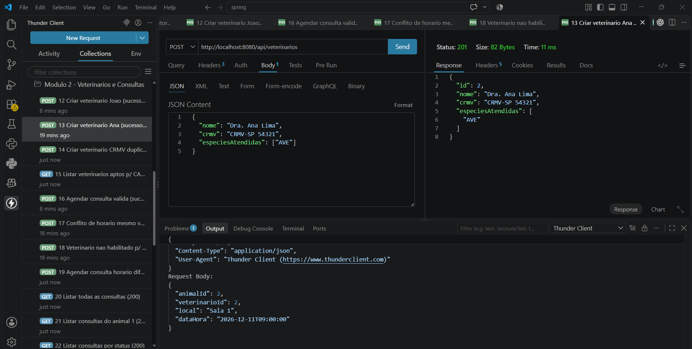 |
| Agendar consulta válida (sucesso 201) | 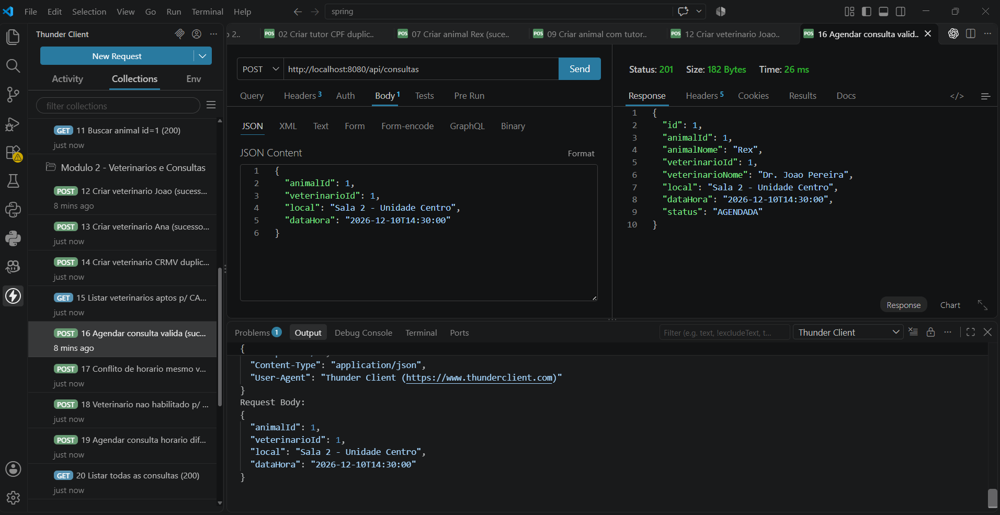 |
| Conflito de horário do mesmo veterinário (erro 409) | 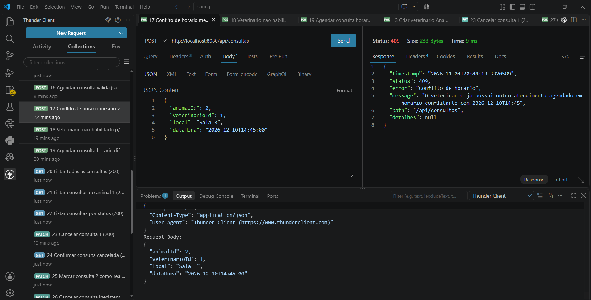 |
| Veterinário não habilitado para a espécie (erro 400) | 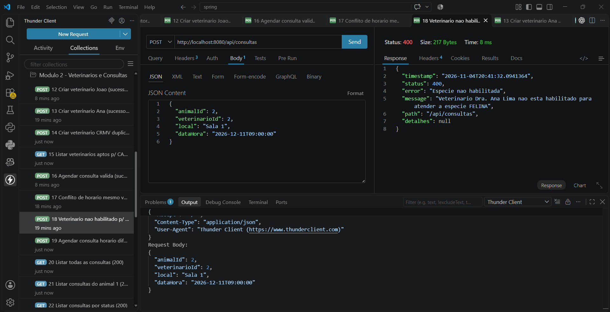 |
| Agendar segunda consulta em horário livre (sucesso 201) | 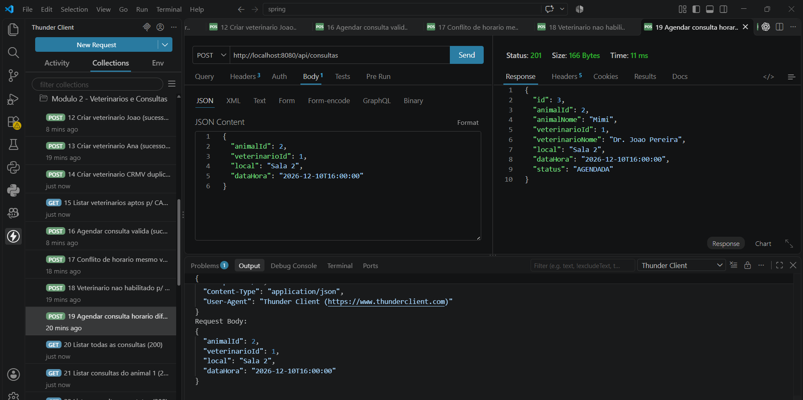 |
| Cancelar consulta (sucesso 200, não deleta) | 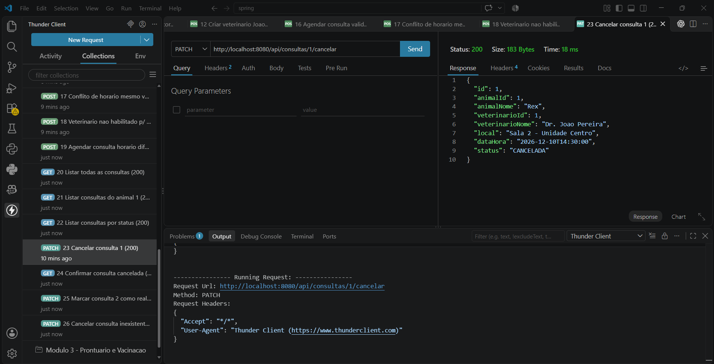 |
| Criar atendimento / prontuário (sucesso 201) | 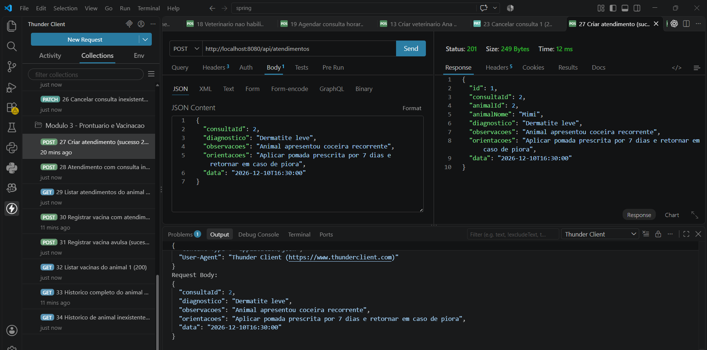 |
| Registrar vacina vinculada a atendimento (sucesso 201) | 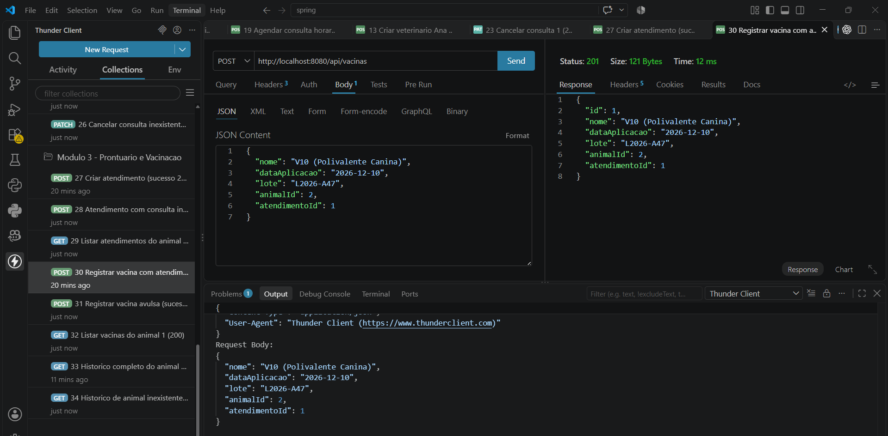 |
| Registrar vacina avulsa (sucesso 201) | 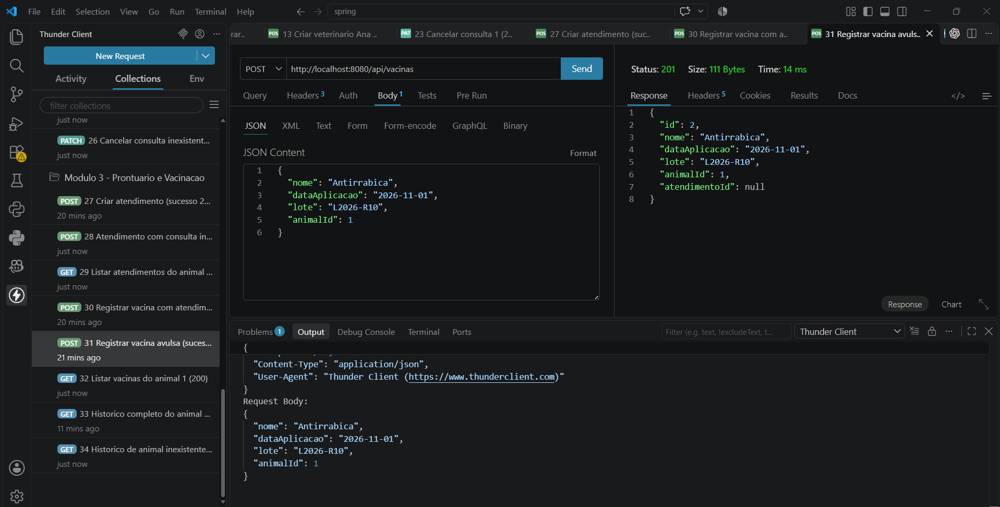 |
| Histórico completo do animal (sucesso 200) | 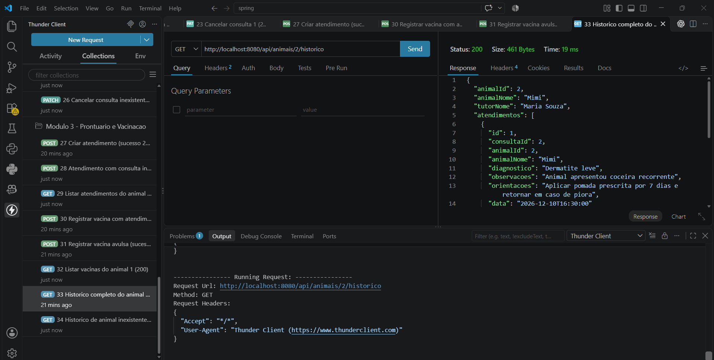 |

## Diagrama de classes

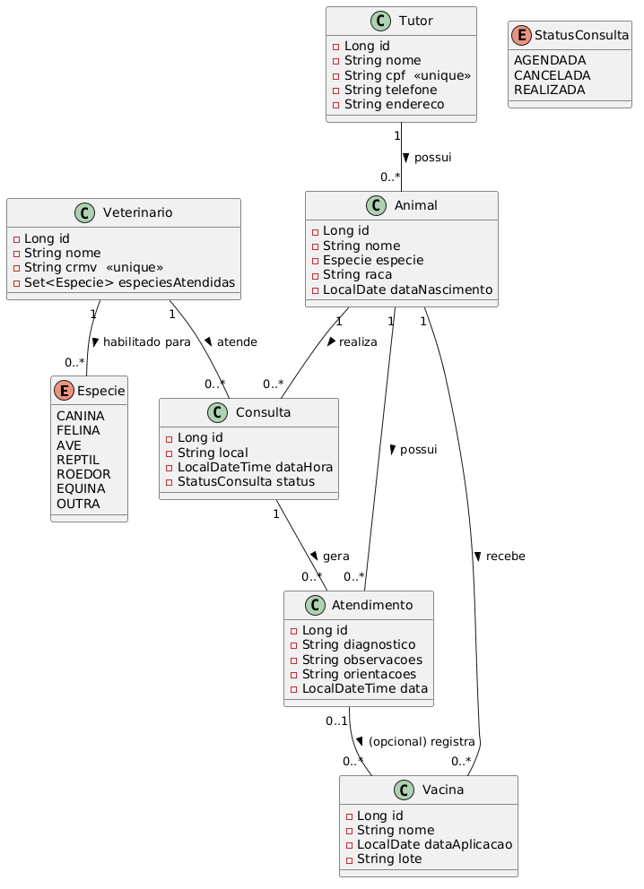

Veja `DIAGRAMA_UML.md` para a descrição completa do diagrama UML (entidades, atributos e
relacionamentos).
